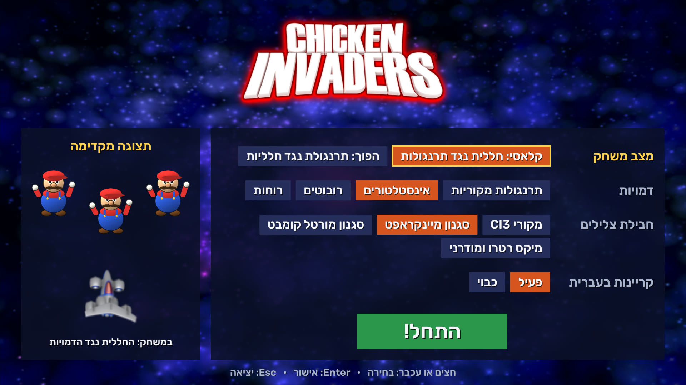
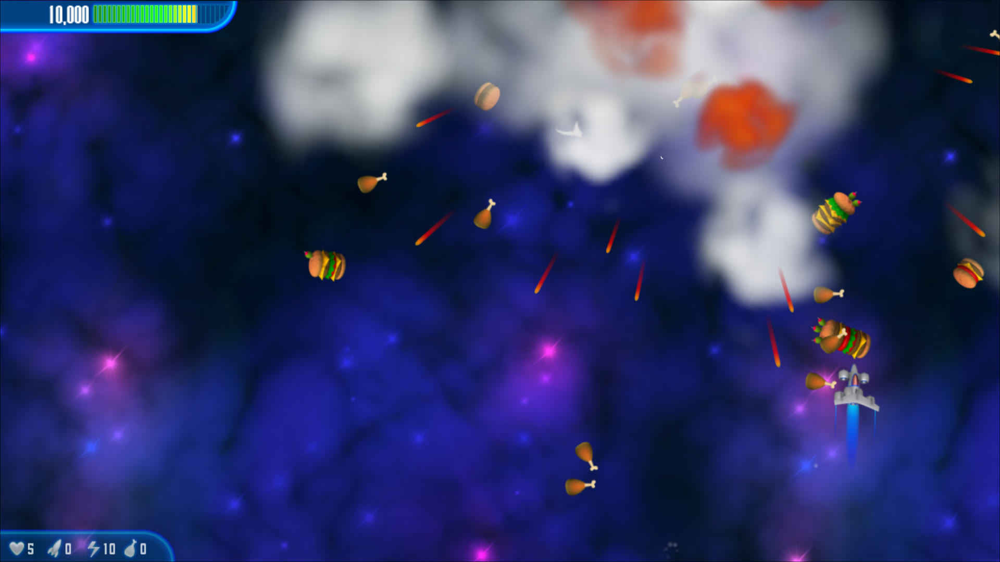
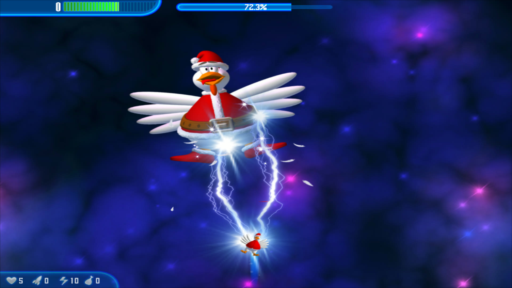
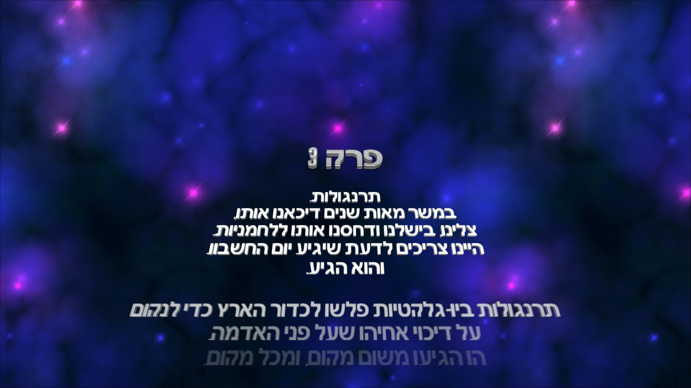

<div dir="rtl">

# פולשי התרנגולות 3: נקמת החלמון, בעברית וב-4K

משגר עברי ל-**Chicken Invaders: Revenge of the Yolk, Christmas Edition (גרסה 3.20)**. המשחק שרץ הוא **המשחק המקורי עצמו**: אותו מנוע, אותם גלים, בוסים, נשקים, גרפיקה ומוזיקה. המשגר מוסיף עליו את האפשרויות שלמטה.

מיזם מעריצים לא רשמי, ללא קשר ל-InterAction studios. **הריפו והקובץ להורדה לא כוללים קבצי משחק.** צריך עותק מותקן משלך, והמשגר רק קורא ממנו ולא משנה אותו.






## מה יש כאן

| תכונה | מה קורה בפועל |
|---|---|
| מסך מלא בלי פסים שחורים | שדה הראייה של המנוע מורחב לפי צורת המסך, כך שהתמונה ממלאת 16:9 בלי עיוות |
| 4K | עיבוד ברזולוציית המסך המלאה דרך dgVoodoo2 |
| 65Hz | שלב הסימולציה של המנוע הוא 1/65 שנייה, ו-dgVoodoo2 מגביל ל-65 פריימים. כדי לראות 65 פריימים צריך מסך שתומך בכך |
| עברית | 629 מחרוזות מתורגמות וגופנים עם אותיות עבריות, בסדר ימין לשמאל |
| מצב הפוך | השחקן הוא תרנגולת (או דמות אחרת), התרנגולות הן חלליות, והביצים והיריות מתחלפות |
| דמויות | תרנגולות מקוריות, אינסטלטורים, רובוטים, רוחות, או כל PNG שתוסיף |
| חבילות צלילים | מקורי, סגנון מיינקראפט, סגנון מורטל קומבט, מיקס רטרו ומודרני |
| קריינות | "כל הכבוד!", "יאי!", "אליפות!", "מצוין!" ו"זהירות, בוס!" במקום צלילים של אירועים במשחק |

## מגבלות

- **שדרוג AI לגרפיקה לא קיים.** המנוע קובע את גודל הציור לפי מידות הספרייט, ולכן קובץ גדול יותר לא מתקבל בלי שינוי נוסף בקוד של המשחק.
- **אין שלבים או בוסים חדשים.** הם קבועים בתוך קובץ ה-exe של המקור.
- **המצב ההפוך הוא שינוי מראה.** החוקים נשארים של המקור, ובוסים נשארים תרנגולות ענק.
- **חבילות מיינקראפט ומורטל קומבט הן צלילים מקוריים בסגנון דומה**, לא הקבצים של המשחקים האלה. אפשר להוסיף קבצים משלך, ראו למטה.
- **הקריינות מחליפה צלילים קיימים ואין לה כתוביות**, כי המנוע לא מאפשר להוסיף אירועים. היא נוצרה בקול Microsoft Asaf.

## התקנה

1. מתקינים את המשחק המקורי (גרסה 3.20 Christmas Edition).
2. מורידים את `ci3-hebrew-4k.exe` מ-[Releases](https://github.com/dor2500/ci3-hebrew-4k/releases) ומפעילים.
3. בוחרים מצב, דמויות וצלילים ולוחצים **התחל!**

בהפעלה הראשונה המשגר מוריד את dgVoodoo2 מ-GitHub ובודק את החתימה שלו. קבצי המשחק שנבנו נשמרים ב-`%LOCALAPPDATA%\CI3Hebrew4K`.

אם המשחק מותקן במקום אחר, כותבים את הנתיב לתיקייה בקובץ `ci3_path.txt` ליד המשגר.

## התאמה אישית

ליד `ci3-hebrew-4k.exe`:

- `skins\mario.png`: דמות חדשה ברשימה, בשם הקובץ.
- `soundpacks\<id>\(laser).ogg`: מחליף צליל בחבילה. המזהים הם `original`, `blocks`, `kombat` ו-`mix`, ושם הקובץ הוא שם הצליל במשחק.

## סרטונים

- משחק קלאסי: *(קישור יתווסף)*
- מצב הפוך: *(קישור יתווסף)*

## בנייה מהקוד

</div>

```bash
go test ./...
go build -trimpath -ldflags "-s -w -H windowsgui" -o dist/ci3-hebrew-4k.exe .
```

<div dir="rtl">

דרוש Go 1.27.2 ומעלה. `tools/genpacks` יוצר מחדש את חבילות הצלילים (דורש ffmpeg), ו-`tools/gen_voices.ps1` את הקריינות.

## רישיונות

גופן Rubik ברישיון SIL OFL (`assets/fonts/OFL.txt`). dgVoodoo2 שייך ל-Dege ומורד ישירות ממנו. Chicken Invaders שייך ל-InterAction studios.

</div>
